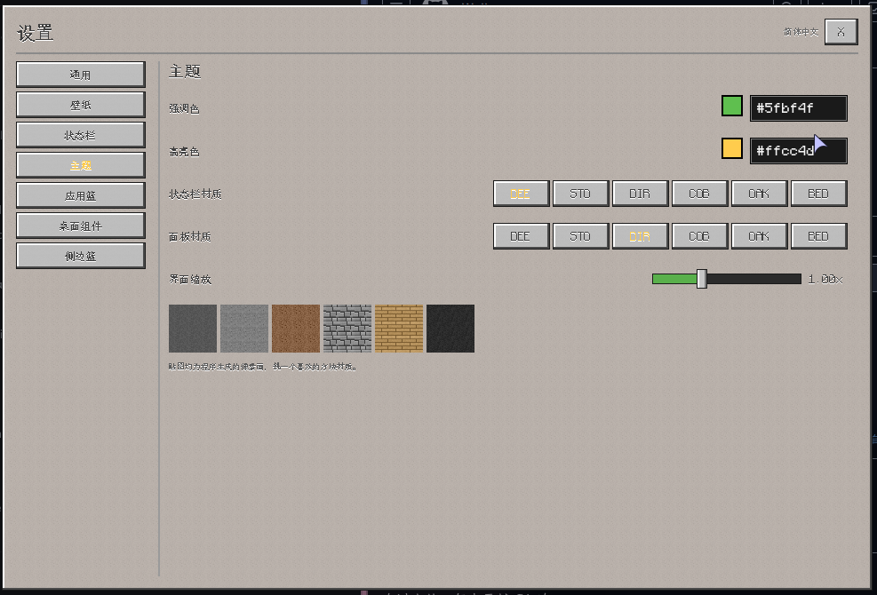
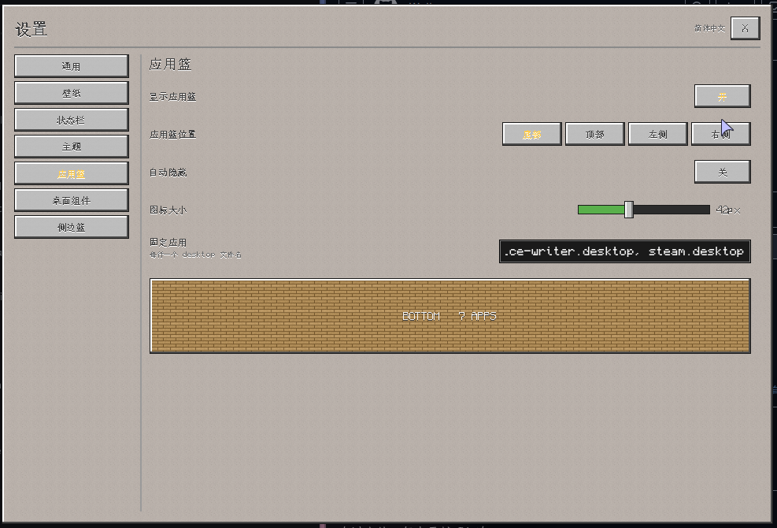
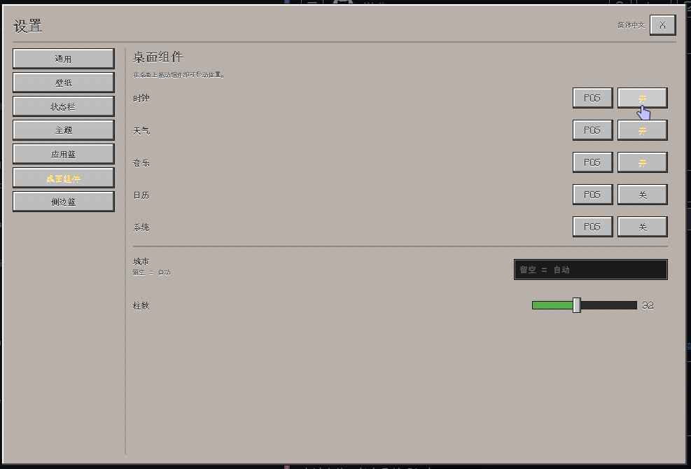
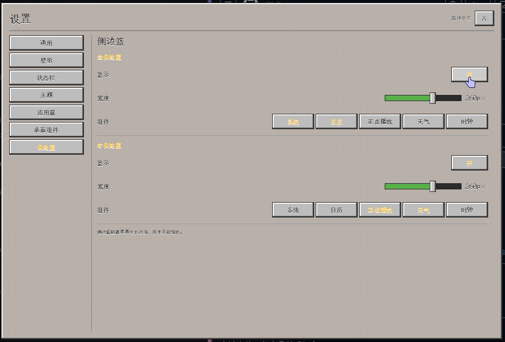
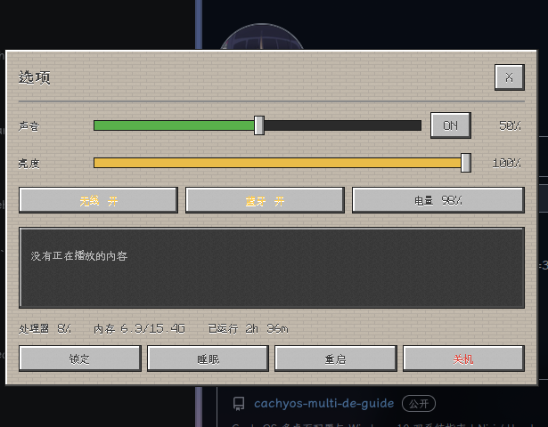

# MC-shell

A **Minecraft-styled desktop shell** for [Quickshell](https://quickshell.org), made for
**Hyprland** and **niri**. Status bar, player-inventory dock, launcher, control centre,
settings screen, desktop widgets, side baskets, power menu and toasts — all rendered like
blocks, hotbar slots and stone GUI panels.

**English · 简体中文 · 繁體中文** — the whole UI is translated and switches live.


## Screenshots

| Player-inventory dock | Launcher |
|---|---|
|  |  |

| Settings · general | Settings · bar |
|---|---|
|  |  |

| Settings · theme | Settings · dock |
|---|---|
|  |  |

| Settings · widgets | Settings · side baskets |
|---|---|
|  |  |

| Power menu | Options / OSD |
|---|---|
|  |   |

## What's inside

### Bar (4 edges)
Hotbar workspaces, window title, `DAY n · HH:MM` clock, CPU hearts, RAM drumsticks,
NET / VOL / BAT chips, tray icons, settings and power buttons. The bar can sit on the
**top, bottom, left or right** edge and swaps between a horizontal row and a vertical
column automatically.

### Dock — the player inventory
A wooden 9×3 inventory basket of app slots. Pin your apps, change the icon size, move the
dock to **any of the four edges**, or let it auto-hide behind a 4px strip. Empty slots are
drawn too, because an inventory without empty slots isn't an inventory.

### Launcher
Searchable app grid (type / arrows / Enter / Esc), mouse wheel scrolling.

### Settings screen
One tab per feature group, all changes apply live and are written to
`~/.config/mc-shell/config.json`:

- **General** — language (auto / English / 简体中文 / 繁體中文), shortcut cheat sheet, reset
- **Wallpaper** — enable MC-shell's own background layer, image path, fallback colour, fill mode
- **Bar** — visibility, edge, thickness, which HUD parts to show
- **Theme** — accent + highlight colours, bar/panel block texture, UI scale, texture preview
- **Dock** — visibility, edge, auto-hide, icon size, pinned apps
- **Widgets** — enable each desktop card, reset its position, weather city, visualiser bar count
- **Side baskets** — left/right basket on-off, width, and which widgets they carry

### Desktop widgets
Draggable cards on the wallpaper layer: **clock**, **weather** (wttr.in, no API key),
**music visualiser** (real spectrum from `cava`), **calendar**, **system stats**.
Positions are stored as screen ratios and can be reset from Settings.

### Side baskets
Left and right edge panels ("baskets") that host any combination of system, calendar,
now-playing, weather and clock cards.

### Power menu
A Minecraft title screen: grass-block logo, `MC-SHELL`, and world-action buttons —
return to game (lock), save & quit (sleep), leave session, respawn (reboot),
quit to desktop (power off), back to game.

### Everything else
- **Options / control centre** — volume + brightness sliders, Wi-Fi/Bluetooth, MPRIS media,
  session stats, lock/sleep/reboot/off.
- **XP-bar OSD** for volume and brightness, driven by compositor keybindings over IPC.
- **Notification daemon + advancement-style toasts**.
- **Pixel-perfect theming** — bundled Monocraft font, procedurally generated 16×16
  textures (dirt, stone, cobblestone, oak planks, bedrock, deepslate, hearts, hunger,
  weather and UI icons), hard 3D bevels, no rounded corners.

## Requirements

| Dependency | Notes |
|---|---|
| `quickshell` ≥ 0.3 | `qs --version`; developed against 0.3.2 |
| Hyprland **or** niri | auto-detected from `HYPRLAND_INSTANCE_SIGNATURE` / `NIRI_SOCKET` |
| PipeWire | volume read/write via `Quickshell.Services.Pipewire` |
| `curl` | weather widget (wttr.in) |
| `cava` | optional — real audio spectrum; the visualiser stays flat without it |
| `brightnessctl` | optional — the brightness slider hides itself if missing |
| `loginctl`, `systemctl` | lock / sleep / reboot / power off |

## Install

```sh
git clone https://github.com/Wglly/MC-shell.git
cd MC-shell
./install.sh          # -> ~/.config/quickshell/mc-shell + ~/.local/bin/mc-shell
mc-shell              # start it
```

Autostart:

```ini
# Hyprland
exec-once = mc-shell
```

```kdl
// niri
spawn-at-startup "mc-shell"
```

> MC-shell reserves the edge its bar sits on, and draws its own wallpaper only if you
> enable it. Disable any other bar before using MC-shell.

## Keybindings

Everything is exposed over Quickshell IPC:

```ini
# Hyprland
bind = SUPER, D, exec, mc-shell ipc call shell launcher
bind = SUPER, X, exec, mc-shell ipc call shell control
bind = SUPER, C, exec, mc-shell ipc call shell settings
bind = SUPER, P, exec, mc-shell ipc call shell power
bind = , XF86AudioRaiseVolume,  exec, mc-shell ipc call shell volumeUp
bind = , XF86AudioLowerVolume,  exec, mc-shell ipc call shell volumeDown
bind = , XF86AudioMute,         exec, mc-shell ipc call shell volumeMute
bind = , XF86MonBrightnessUp,   exec, mc-shell ipc call shell brightnessUp
bind = , XF86MonBrightnessDown, exec, mc-shell ipc call shell brightnessDown
```

```kdl
// niri
Mod+D { spawn "mc-shell" "ipc" "call" "shell" "launcher"; }
Mod+X { spawn "mc-shell" "ipc" "call" "shell" "control"; }
Mod+C { spawn "mc-shell" "ipc" "call" "shell" "settings"; }
Mod+P { spawn "mc-shell" "ipc" "call" "shell" "power"; }
XF86AudioRaiseVolume { spawn "mc-shell" "ipc" "call" "shell" "volumeUp"; }
XF86AudioLowerVolume { spawn "mc-shell" "ipc" "call" "shell" "volumeDown"; }
XF86AudioMute        { spawn "mc-shell" "ipc" "call" "shell" "volumeMute"; }
XF86MonBrightnessUp   { spawn "mc-shell" "ipc" "call" "shell" "brightnessUp"; }
XF86MonBrightnessDown { spawn "mc-shell" "ipc" "call" "shell" "brightnessDown"; }
```

### IPC reference

| Call | Effect |
|---|---|
| `shell launcher` / `control` / `settings` / `power` | toggle an overlay |
| `shell close` | close whatever is open |
| `shell volumeUp` / `volumeDown` / `volumeMute` | audio + OSD |
| `shell brightnessUp` / `brightnessDown` | brightness + OSD |
| `shell focus <id>` / `stepWorkspace <±1>` | workspace control |
| `shell workspaces` / `backend` | debug readouts |
| `shell language <auto\|en\|zh_CN\|zh_TW>` | switch language |
| `shell set <dotted.key> <value>` | write any setting, e.g. `set bar.position left` |
| `shell settingsTab <0-6>` | open a settings tab |

## Configuration

Settings are edited in the GUI and stored as JSON:

```json
{
  "language": "auto",
  "bar":   { "position": "top", "visible": true, "thickness": 40, "showStats": true },
  "dock":  { "position": "bottom", "iconSize": 42, "autoHide": false, "pinned": ["firefox.desktop"] },
  "theme": { "accent": "#5fbf4f", "gold": "#ffcc4d", "barTexture": "deepslate", "panelTexture": "dirt" },
  "wallpaper": { "enabled": false, "path": "", "color": "#101418", "fillMode": "fill" },
  "widgets": { "clock": { "enabled": true, "x": 0.06, "y": 0.10 } },
  "sidebars": { "left": { "enabled": true, "width": 260, "widgets": ["stats", "calendar"] } }
}
```

`bar.position` and `dock.position` accept `top` / `bottom` / `left` / `right`.

## How compositor support works

```
services/Compositor.qml   one API for both compositors
├── Hyprland: Quickshell.Hyprland (event driven, no polling)
└── niri:     `niri msg --json workspaces` + `focused-window`, refreshed from
              `niri msg event-stream` (debounced) with a 3 s safety poll;
              actions go through `niri msg action focus-workspace`
```

No extra QML plugin is required for niri.

## Theming

- `modules/common/Theme.qml` — colours, sizes, font, texture lookup.
- `assets/textures/` — generated by `python3 scripts/gen_textures.py` (Pillow).
  Edit the script and re-run to change any block, heart, hunger, weather or UI icon.
- `assets/fonts/Monocraft.ttf` — SIL OFL 1.1.

## Project layout

```
shell.qml                       entry point: font, theme bindings, all windows, IPC
modules/common/                 Theme, Settings-driven widgets (McPanel, Slot, Chip, ...)
modules/bar/                    Bar + workspaces, clock, stats, chips, tray, title
modules/dock/                   player-inventory dock
modules/launcher/               inventory launcher
modules/control/                options / control centre
modules/settings/               settings window + 7 pages
modules/widgets/                clock, weather, visualiser, calendar, stats cards + desktop hosts
modules/sidebars/               left/right baskets
modules/wallpaper/              background layer
modules/power/                  title-screen power menu
modules/osd/                    XP-bar OSD
modules/notifications/          advancement toasts
services/                       Settings, I18n, Compositor, Audio, Stats, Apps, System, Weather, Visualiser, Notifs
assets/                         Monocraft font, generated textures, icon
scripts/gen_textures.py         texture generator
```

## Status

- Hyprland backend: verified live on Hyprland 0.57.2 (Wayland), 1920×1080.
- niri backend: exercised against a mocked `niri msg` CLI (workspace model, focus
  actions, focused-window title). Please open an issue if your niri version differs.
- Notification toasts only appear when no other daemon owns `org.freedesktop.Notifications`.

## Credits

- Layout and interaction ideas from [quickshell-niri](https://github.com/imiric/quickshell-niri)
  (MIT, © The Ink Serpent) and [anomshell](https://github.com/atif-1402/anomshell)
  (MIT, © atif-1402).
- [Monocraft](https://github.com/IdreesInc/Monocraft) font (SIL OFL 1.1).
- [Quickshell](https://quickshell.org) by outfoxxed.
- Not affiliated with Mojang or Microsoft. All textures are original pixel art generated
  by this repository; no Minecraft assets are included.

## 中文速览

- **是什麼**：Quickshell 寫的 Minecraft 風格桌面 shell，支援 Hyprland 與 niri。
- **安裝**：`./install.sh`，再執行 `mc-shell`；Hyprland 用 `exec-once = mc-shell`，
  niri 用 `spawn-at-startup "mc-shell"`。
- **設定**：`mc-shell ipc call shell settings` 開啟設定頁（壁紙 / 狀態列 / 主題 /
  應用籃 / 桌面元件 / 側邊籃），所有變更即時生效並存到
  `~/.config/mc-shell/config.json`。
- **語言**：設定 → 一般 → 語言，可選自動 / English / 简体中文 / 繁體中文。
- **狀態列與應用籃**：可在上、下、左、右四邊自由切換。
- **桌面元件**：時鐘、天氣、音樂可視化（cava）、日曆、系統，可直接拖動。

## License

MIT — see [LICENSE](LICENSE).
