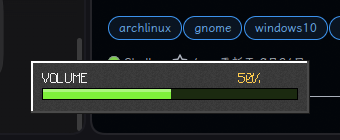

# MC-shell

A **Minecraft-styled desktop shell** for [Quickshell](https://quickshell.org), made for
**Hyprland** and **niri**. Status bar, app launcher, control centre, OSD and
notification toasts — all rendered like blocks, hotbar slots and stone GUI panels.


| Inventory (launcher) | Options (control centre) |
|---|---|
|  |  |
| **XP-bar OSD** | |
|  | |

## What's inside

- **Hotbar workspaces** — one inventory slot per workspace, numbered, current one
  framed in white. Click to switch. Works with **Hyprland** (`Quickshell.Hyprland`)
  and **niri** (`niri msg`, no extra QML plugin needed).
- **HUD stats** — CPU as hearts, RAM as hunger drumsticks, live from `/proc`.
- **Bar readouts** — active window title, `DAY n · HH:MM` clock, NET / VOL / BAT
  chips, system tray icons, power button.
- **Inventory launcher** — searchable `.desktop` app grid, keyboard driven
  (type / arrows / Enter / Esc), mouse wheel scroll.
- **Options control centre** — volume and brightness sliders, Wi-Fi and Bluetooth
  toggles, MPRIS media controls, session stats, lock / sleep / reboot / power off.
- **XP-bar OSD** — volume and brightness feedback in Minecraft's XP bar style,
  also driven from compositor keybindings over IPC.
- **Notification toasts** — notification daemon plus advancement-style popups.
- **Pixel-perfect theming** — bundled [Monocraft](https://github.com/IdreesInc/Monocraft)
  font, procedurally generated 16×16 textures, hard 3D bevels, no rounded corners.

## Requirements

| Dependency | Notes |
|---|---|
| `quickshell` ≥ 0.3 | `qs --version`; the shell is tested on 0.3.2 |
| Hyprland **or** niri | both backends are auto-detected from the environment |
| PipeWire | volume read/write via `Quickshell.Services.Pipewire` |
| `brightnessctl` | optional; the brightness slider hides itself if missing |
| `loginctl`, `systemctl` | lock / sleep / reboot / power off |
| `niri` ≥ 25 | only when using the niri backend (talks to `niri msg`) |

## Install

```sh
git clone https://github.com/<you>/MC-shell.git
cd MC-shell
./install.sh                  # copies to ~/.config/quickshell/mc-shell + ~/.local/bin/mc-shell
```

Then run it:

```sh
mc-shell                      # wrapper for: qs -p ~/.config/quickshell/mc-shell
```

Autostart:

```ini
# Hyprland
exec-once = mc-shell
```

```kdl
// niri
spawn-at-startup "mc-shell"
```

> **Note** — MC-shell reserves the top edge of the screen. Disable any other
> status bar (waybar, another quickshell config, …) before using it.

## Keybindings

Everything is exposed over Quickshell IPC, so compositor binds are one-liners.

```ini
# Hyprland
bind = SUPER, D, exec, mc-shell ipc call shell launcher
bind = SUPER, X, exec, mc-shell ipc call shell control
bind = , XF86AudioRaiseVolume,  exec, mc-shell ipc call shell volumeUp
bind = , XF86AudioLowerVolume,  exec, mc-shell ipc call shell volumeDown
bind = , XF86AudioMute,         exec, mc-shell ipc call shell volumeMute
bind = , XF86MonBrightnessUp,   exec, mc-shell ipc call shell brightnessUp
bind = , XF86MonBrightnessDown, exec, mc-shell ipc call shell brightnessDown
```

```kdl
// niri
Mod+D { spawn "mc-shell" "ipc" "call" "shell" "launcher"; }
Mod+X { spawn "mc-shell" "ipc" "call" "shell" "control"; }
XF86AudioRaiseVolume { spawn "mc-shell" "ipc" "call" "shell" "volumeUp"; }
XF86AudioLowerVolume { spawn "mc-shell" "ipc" "call" "shell" "volumeDown"; }
XF86AudioMute        { spawn "mc-shell" "ipc" "call" "shell" "volumeMute"; }
XF86MonBrightnessUp   { spawn "mc-shell" "ipc" "call" "shell" "brightnessUp"; }
XF86MonBrightnessDown { spawn "mc-shell" "ipc" "call" "shell" "brightnessDown"; }
```

### IPC reference

| Call | Effect |
|---|---|
| `mc-shell ipc call shell launcher` | toggle the inventory |
| `mc-shell ipc call shell control` | toggle the options panel |
| `mc-shell ipc call shell close` | close whatever is open |
| `mc-shell ipc call shell volumeUp` / `volumeDown` / `volumeMute` | audio + OSD |
| `mc-shell ipc call shell brightnessUp` / `brightnessDown` | brightness + OSD |
| `mc-shell ipc call shell focus <id>` | focus workspace by id |
| `mc-shell ipc call shell stepWorkspace <±1>` | cycle workspaces |
| `mc-shell ipc call shell workspaces` | JSON workspace list (debug) |
| `mc-shell ipc call shell backend` | `hyprland` / `niri` / `none` |

## How the compositor support works

```
services/Compositor.qml   one API for both compositors
├── Hyprland: Quickshell.Hyprland (event driven, no polling)
└── niri:     `niri msg --json workspaces` + `niri msg --json focused-window`
              refreshed by `niri msg event-stream` (debounced), plus a 3 s
              safety poll; actions go through `niri msg action focus-workspace`
```

The backend is picked from `HYPRLAND_INSTANCE_SIGNATURE` / `NIRI_SOCKET`, so the
same config works on both compositors with no edits.

## Theming

`modules/common/Theme.qml` holds every colour, size and font setting.
Textures live in `assets/textures/` and are generated by
`python3 scripts/gen_textures.py` (Pillow) — edit the script and re-run it to
change the dirt, stone, planks, hearts, hunger and slot art.

## Project layout

```
shell.qml                     entry point: font, bar(s), overlays, IPC
modules/common/               Theme, ShellState, Util + McPanel/Slot/Chip/McSlider/PixelText
modules/bar/                  Bar, Workspaces, Clock, StatsHud, TrayRow
modules/launcher/             inventory launcher
modules/control/              options / control centre
modules/osd/                  XP-bar OSD
modules/notifications/        advancement toasts
services/                     Compositor, Audio, Stats, Apps, System, Notifs
assets/                       Monocraft font, generated textures, icon
scripts/gen_textures.py       texture generator
```

## Status

- Hyprland backend: tested live on Hyprland 0.57.2 (Wayland).
- niri backend: exercised against a mocked `niri msg` CLI (workspace model,
  focus actions, title) — please open an issue if your niri version differs.
- Notification toasts only appear when no other daemon owns
  `org.freedesktop.Notifications`.

## Credits

- Layout and interaction ideas from [quickshell-niri](https://github.com/imiric/quickshell-niri)
  (MIT, © The Ink Serpent) and [anomshell](https://github.com/atif-1402/anomshell)
  (MIT, © atif-1402).
- [Monocraft](https://github.com/IdreesInc/Monocraft) font (SIL OFL 1.1).
- Built with [Quickshell](https://quickshell.org).
- Not affiliated with Mojang or Microsoft. All textures are original pixel art
  generated by this repository; no Minecraft assets are included.

## 中文速览

- **是什么**：用 Quickshell 写的 Minecraft 风格桌面 shell，支持 Hyprland 与 niri。
- **安装**：`./install.sh`，然后 `mc-shell` 启动；`exec-once = mc-shell`（Hyprland）
  或 `spawn-at-startup "mc-shell"`（niri）。
- **快捷键**：`mc-shell ipc call shell launcher` / `control`，音量、亮度同理（见上）。
- **主题**：改 `modules/common/Theme.qml`；贴图由 `scripts/gen_textures.py` 生成。

## License

MIT — see [LICENSE](LICENSE).
