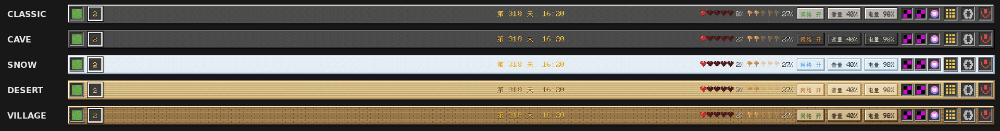
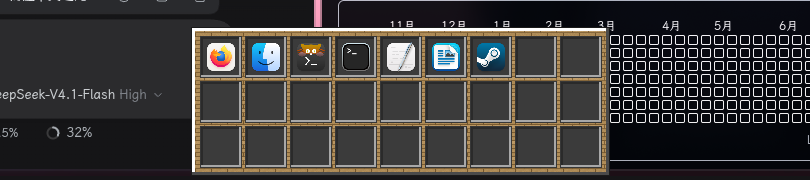
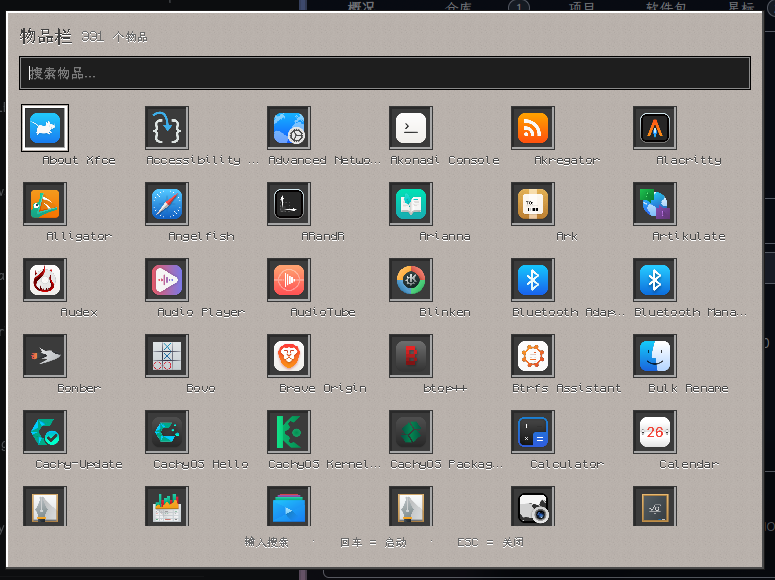

# MC-shell

[](LICENSE)
[](https://archlinux.org)
[](https://wayland.freedesktop.org)
[](#合成器支持)
[](https://quickshell.org)

[English](README.md) · **简体中文** · [繁體中文](README.zh-TW.md)

一个 **Minecraft 风格的 Quickshell 桌面**，支持 **Hyprland** 与 **niri**。
状态栏、玩家物品栏式应用舱、启动器、控制中心、设置界面、桌面组件、侧边篮、电源菜单与通知，
全部用方块、快捷栏与石质 GUI 面板绘制。

**English · 简体中文 · 繁體中文** —— 整个界面已翻译，可实时切换。

**七套内置主题** —— classic、cave、snow、desert、village、Windows XP、Windows 95，
每套都是完整的调色板 + 方块材质，可在 设置 → 主题 中切换。



## 截图

| 玩家物品栏应用舱 | 启动器 |
|---|---|
|  |  |

| 设置 · 通用 | 设置 · 状态栏 |
|---|---|
|  |  |

## 功能

### 状态栏（可放四边）

工作区数字方块、窗口标题、时钟（可紧凑）、CPU/内存、网络速率、音量、电量、托盘、
主题切换、概览、仪表盘、**左右侧边篮开关**、设置与电源按钮。

### 应用舱 —— 玩家物品栏

行/列完全自由（1–12 列 × 1–6 行），可钉选应用、调整图标大小、放到任意一边。
除钉选应用外，还会列出**当前工作区正在运行的应用**（绿点 = 运行中，金点 = 已钉选）；
左键聚焦/启动，右键弹出钉选菜单。**最后一格固定为启动器按钮**。

开启「自动避让」后，工作区有窗口时应用舱会缩成一条细边，鼠标移到边缘才展开，
并通过背景层预留空间让**窗口自动上移**，不会遮挡内容。

### 仪表盘 · 桌面概览 · 启动器

- 仪表盘：3×2 组件（时钟、天气、音乐、频谱、日历、用户卡）
- 桌面概览：把窗口卡片拖到其他工作区
- 启动器：搜索并启动应用

### 桌面组件

时钟、天气、频谱、日历、性能、媒体、用户卡，可拖动、可缩放，位置按比例保存。

### 侧边篮

左右两侧的组件篮，默认关闭，由状态栏按钮或 `shell basket left|right` 开关。
每个篮子的组件在 设置 → 侧边篮 中勾选。

### 壁纸

内置一张加载画面壁纸；可在壁纸卡片中**粘贴本地目录路径**或用原生目录选择器导入自己的图片。

### 电源菜单

锁定 / 休眠 / 重启 / 关机，带确认提示（不会在未经确认时执行）。

## 环境要求

| 依赖 | 说明 |
|---|---|
| `quickshell` ≥ 0.3 | 开发环境为 0.3.2 |
| Hyprland **或** niri | 通过 `HYPRLAND_INSTANCE_SIGNATURE` / `NIRI_SOCKET` 自动识别 |
| PipeWire | 音量读写 |
| `curl` | 天气组件（wttr.in） |
| `cava` | 可选，音频频谱 |
| `brightnessctl` | 可选，亮度滑块 |
| `loginctl`、`systemctl` | 锁定 / 休眠 / 重启 / 关机 |

## 安装

```sh
git clone https://github.com/Wglly/MC-shell.git
cd MC-shell
./install.sh          # -> ~/.config/quickshell/mc-shell + ~/.local/bin/mc-shell
mc-shell              # 启动
```

自启动：

```ini
# Hyprland
exec-once = mc-shell
```

```kdl
// niri
spawn-at-startup "mc-shell"
```

> MC-shell 会独占状态栏所在的那条边；只有开启壁纸层时才绘制自己的壁纸。
> 使用前请先关闭其他状态栏。

## 快捷键

全部通过 Quickshell IPC 暴露：

```ini
# Hyprland
bind = SUPER, D, exec, mc-shell ipc call shell launcher
bind = SUPER, X, exec, mc-shell ipc call shell control
bind = SUPER, C, exec, mc-shell ipc call shell settings
bind = SUPER, TAB, exec, mc-shell ipc call shell overview
bind = SUPER, P, exec, mc-shell ipc call shell power
bind = , XF86AudioRaiseVolume,  exec, mc-shell ipc call shell volumeUp
bind = , XF86AudioLowerVolume,  exec, mc-shell ipc call shell volumeDown
bind = , XF86AudioMute,         exec, mc-shell ipc call shell volumeMute
bind = , XF86MonBrightnessUp,   exec, mc-shell ipc call shell brightnessUp
bind = , XF86MonBrightnessDown, exec, mc-shell ipc call shell brightnessDown
```

```kdl
// niri
Mod+D { spawn "mc-shell" "ipc" "call" "shell" "launcher"; }
Mod+X { spawn "mc-shell" "ipc" "call" "shell" "control"; }
Mod+C { spawn "mc-shell" "ipc" "call" "shell" "settings"; }
Mod+Tab { spawn "mc-shell" "ipc" "call" "shell" "overview"; }
Mod+P { spawn "mc-shell" "ipc" "call" "shell" "power"; }
```

### IPC 参考

| 调用 | 作用 |
|---|---|
| `shell launcher` / `control` / `settings` / `power` | 开关对应面板 |
| `shell close` | 关闭当前面板 |
| `shell volumeUp` / `volumeDown` / `volumeMute` | 音量 + OSD |
| `shell brightnessUp` / `brightnessDown` | 亮度 + OSD |
| `shell overview` | 桌面概览 |
| `shell basket <left\|right>` | 开关侧边篮 |
| `shell dashboard` | 组件仪表盘 |
| `shell focus <id>` / `stepWorkspace <±1>` | 工作区切换 |
| `shell language <auto\|en\|zh_CN\|zh_TW>` | 切换界面语言 |
| `shell preset <classic\|cave\|snow\|desert\|village\|winxp\|win95>` | 切换主题 |
| `shell wallpaper loading` | 应用内置壁纸 |
| `shell set <dotted.key> <value>` | 修改任意设置 |

## 配置

所有设置保存在 `~/.config/mc-shell/config.json`，修改后 250ms 防抖写盘，
并带有版本号与迁移逻辑。也可以在 设置 界面里改，或在命令行用
`mc-shell ipc call shell set bar.position left`。

## 主题

七套主题：classic、cave、snow、desert、village、**winxp**、**win95**。
每套包含完整的颜色 token（面板、边框、文字、阴影、卡片标题…）与方块材质，
主题切换会同时更新界面与组件配色。

## 项目结构

```
shell.qml                主入口（状态栏、应用舱、面板、组件）
modules/bar/             状态栏与各小部件
modules/dock/            应用舱 + 启动器格 + 右键菜单
modules/sidebars/        左右侧边篮
modules/settings/        设置窗口与各分页
modules/widgets/         卡片式组件
modules/overview/        桌面概览
modules/dashboard/       组件仪表盘
services/                Settings / I18n / Compositor / Apps 等单例
assets/                  字体、材质、壁纸、图标
scripts/                 材质与壁纸生成脚本
```

## 状态

在 CachyOS + Hyprland 0.57（Lua 配置）与 Quickshell 0.3.2 上开发与测试；
niri 支持是同一套抽象层，已在代码路径上实现。

## 致谢

- [Quickshell](https://quickshell.org) —— 整个 shell 的运行时
- [Monocraft](https://github.com/IdreesInc/Monocraft) 字体（SIL OFL 1.1）
- Minecraft 的视觉语言（本仓库不包含任何 Mojang/Microsoft 美术资源）

## 许可证

MIT —— 见 [LICENSE](LICENSE)。
