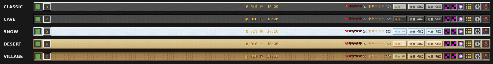
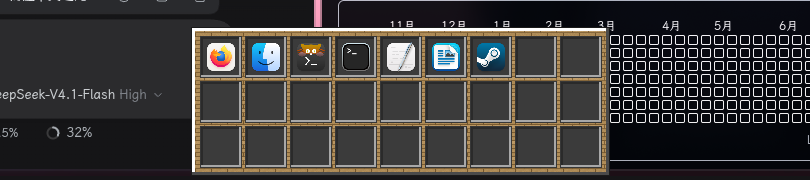
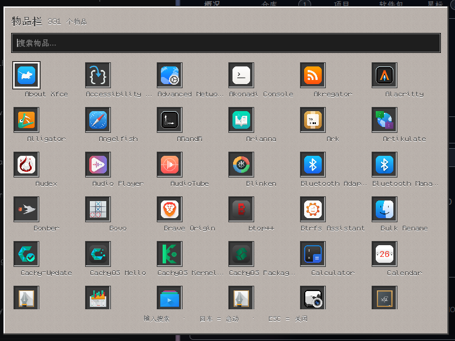

# MC-shell

[](LICENSE)
[](https://archlinux.org)
[](https://wayland.freedesktop.org)
[](#合成器支援)
[](https://quickshell.org)

[English](README.md) · [简体中文](README.zh-CN.md) · **繁體中文**

一個 **Minecraft 風格的 Quickshell 桌面**，支援 **Hyprland** 與 **niri**。
狀態列、玩家物品欄式應用艙、啟動器、控制中心、設定介面、桌面組件、側邊籃、電源選單與通知，
全部以方塊、快捷欄與石質 GUI 面板繪製。

**English · 简体中文 · 繁體中文** —— 整個介面已翻譯，可即時切換。

**七套內建主題** —— classic、cave、snow、desert、village、Windows XP、Windows 95，
每套都是完整的調色盤 + 方塊材質，可在 設定 → 主題 中切換。



## 截圖

| 玩家物品欄應用艙 | 啟動器 |
|---|---|
|  |  |

| 設定 · 一般 | 設定 · 狀態列 |
|---|---|
|  |  |

## 功能

### 狀態列（可放四邊）

工作區數字方塊、視窗標題、時鐘（可精簡）、CPU/記憶體、網路速率、音量、電量、系統匣、
主題切換、概覽、儀表盤、**左右側邊籃開關**、設定與電源按鈕。

### 應用艙 —— 玩家物品欄

列/欄完全自由（1–12 欄 × 1–6 列），可釘選應用、調整圖示大小、放到任意一邊。
除了釘選應用，還會列出**目前工作區正在執行的應用**（綠點 = 執行中，金點 = 已釘選）；
左鍵聚焦/啟動，右鍵開啟釘選選單。**最後一格固定為啟動器按鈕**。

開啟「自動避讓」後，工作區有視窗時應用艙會縮成一條細邊，滑鼠移到邊緣才展開，
並透過背景層預留空間讓**視窗自動上移**，不會遮住內容。

### 儀表盤 · 桌面概覽 · 啟動器

- 儀表盤：3×2 組件（時鐘、天氣、音樂、頻譜、日曆、使用者卡）
- 桌面概覽：把視窗卡片拖到其他工作區
- 啟動器：搜尋並啟動應用

### 桌面組件

時鐘、天氣、頻譜、日曆、效能、媒體、使用者卡，可拖曳、可縮放，位置按比例儲存。

### 側邊籃

左右兩側的組件籃，預設關閉，由狀態列按鈕或 `shell basket left|right` 開關。
每個籃子的組件在 設定 → 側邊籃 中勾選。

### 壁紙

內建一張載入畫面壁紙；可在壁紙卡片中**貼上本機目錄路徑**或用原生目錄選擇器匯入自己的圖片。

### 電源選單

鎖定 / 休眠 / 重新開機 / 關機，附確認提示（未經確認不會執行）。

## 環境需求

| 依賴 | 說明 |
|---|---|
| `quickshell` ≥ 0.3 | 開發環境為 0.3.2 |
| Hyprland **或** niri | 透過 `HYPRLAND_INSTANCE_SIGNATURE` / `NIRI_SOCKET` 自動辨識 |
| PipeWire | 音量讀寫 |
| `curl` | 天氣組件（wttr.in） |
| `cava` | 選用，音訊頻譜 |
| `brightnessctl` | 選用，亮度滑桿 |
| `loginctl`、`systemctl` | 鎖定 / 休眠 / 重新開機 / 關機 |

## 安裝

```sh
git clone https://github.com/Wglly/MC-shell.git
cd MC-shell
./install.sh          # -> ~/.config/quickshell/mc-shell + ~/.local/bin/mc-shell
mc-shell              # 啟動
```

開機自動啟動：

```ini
# Hyprland
exec-once = mc-shell
```

```kdl
// niri
spawn-at-startup "mc-shell"
```

> MC-shell 會獨占狀態列所在的那條邊；只有開啟壁紙層時才會繪製自己的壁紙。
> 使用前請先關閉其他狀態列。

## 快速鍵

全部透過 Quickshell IPC 提供：

```ini
# Hyprland
bind = SUPER, D, exec, mc-shell ipc call shell launcher
bind = SUPER, X, exec, mc-shell ipc call shell control
bind = SUPER, C, exec, mc-shell ipc call shell settings
bind = SUPER, TAB, exec, mc-shell ipc call shell overview
bind = SUPER, P, exec, mc-shell ipc call shell power
bind = , XF86AudioRaiseVolume,  exec, mc-shell ipc call shell volumeUp
bind = , XF86AudioLowerVolume,  exec, mc-shell ipc call shell volumeDown
bind = , XF86AudioMute,         exec, mc-shell ipc call shell volumeMute
bind = , XF86MonBrightnessUp,   exec, mc-shell ipc call shell brightnessUp
bind = , XF86MonBrightnessDown, exec, mc-shell ipc call shell brightnessDown
```

```kdl
// niri
Mod+D { spawn "mc-shell" "ipc" "call" "shell" "launcher"; }
Mod+X { spawn "mc-shell" "ipc" "call" "shell" "control"; }
Mod+C { spawn "mc-shell" "ipc" "call" "shell" "settings"; }
Mod+Tab { spawn "mc-shell" "ipc" "call" "shell" "overview"; }
Mod+P { spawn "mc-shell" "ipc" "call" "shell" "power"; }
```

### IPC 參考

| 呼叫 | 作用 |
|---|---|
| `shell launcher` / `control` / `settings` / `power` | 開關對應面板 |
| `shell close` | 關閉目前面板 |
| `shell volumeUp` / `volumeDown` / `volumeMute` | 音量 + OSD |
| `shell brightnessUp` / `brightnessDown` | 亮度 + OSD |
| `shell overview` | 桌面概覽 |
| `shell basket <left\|right>` | 開關側邊籃 |
| `shell dashboard` | 組件儀表盤 |
| `shell focus <id>` / `stepWorkspace <±1>` | 工作區切換 |
| `shell language <auto\|en\|zh_CN\|zh_TW>` | 切換介面語言 |
| `shell preset <classic\|cave\|snow\|desert\|village\|winxp\|win95>` | 切換主題 |
| `shell wallpaper loading` | 套用內建壁紙 |
| `shell set <dotted.key> <value>` | 修改任意設定 |

## 設定

所有設定儲存在 `~/.config/mc-shell/config.json`，修改後 250ms 防抖寫入，
並帶有版本號與遷移邏輯。也可以在 設定 介面裡改，或用命令列
`mc-shell ipc call shell set bar.position left`。

## 主題

七套主題：classic、cave、snow、desert、village、**winxp**、**win95**。
每套包含完整的顏色 token（面板、邊框、文字、陰影、卡片標題…）與方塊材質，
切換主題會同時更新介面與組件配色。

## 專案結構

```
shell.qml                主入口（狀態列、應用艙、面板、組件）
modules/bar/             狀態列與各小部件
modules/dock/            應用艙 + 啟動器格 + 右鍵選單
modules/sidebars/        左右側邊籃
modules/settings/        設定視窗與各分頁
modules/widgets/         卡片式組件
modules/overview/        桌面概覽
modules/dashboard/       組件儀表盤
services/                Settings / I18n / Compositor / Apps 等單例
assets/                  字型、材質、壁紙、圖示
scripts/                 材質與壁紙產生腳本
```

## 狀態

在 CachyOS + Hyprland 0.57（Lua 設定）與 Quickshell 0.3.2 上開發與測試；
niri 支援走同一套抽象層，已在程式路徑上實作。

## 致謝

- [Quickshell](https://quickshell.org) —— 整個 shell 的執行環境
- [Monocraft](https://github.com/IdreesInc/Monocraft) 字型（SIL OFL 1.1）
- Minecraft 的視覺語言（本倉庫不包含任何 Mojang/Microsoft 美術資源）

## 授權條款

MIT —— 見 [LICENSE](LICENSE)。
